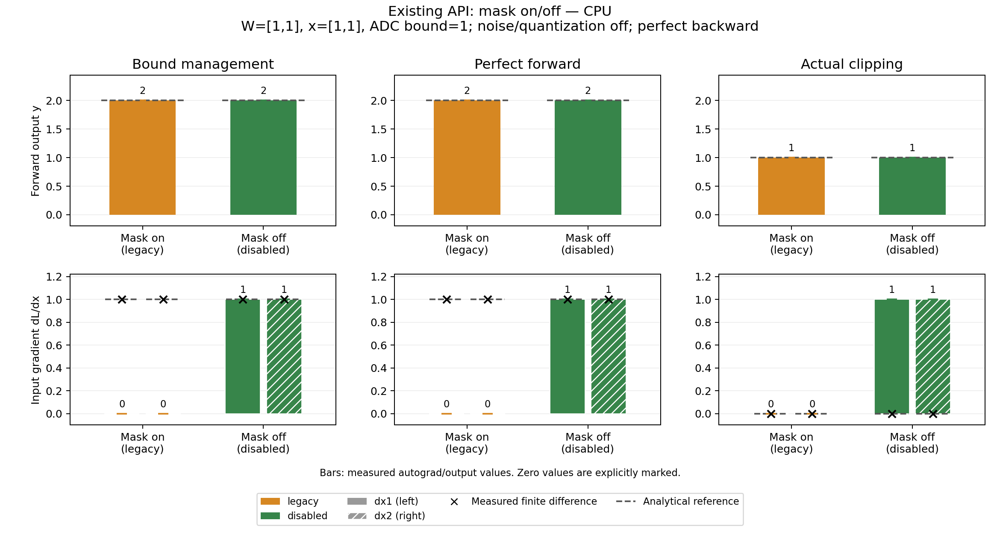
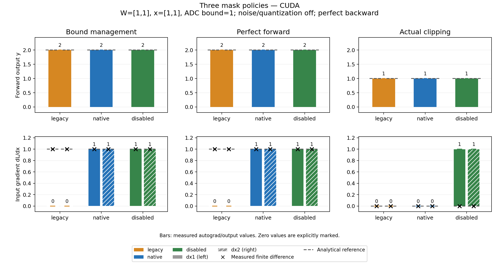

# Output-gradient-mask reproduction and comparison

This experimental fork is based on upstream
`7f22aa7ff0054609fa120d1c2696414460f13f91` (source version 1.2.0).
The initial reproduction-only commit `dda0a9a` remains available. Later commits
add an experimental correction and measured comparison figures. No MNIST
training code, dataset, checkpoint or training-accuracy conclusion is included.

- [Standalone existing-API reproducer](reproduce_upstream.py)
- [Fork-specific three-mode comparison](compare_modes.py)
- [JSON-only plotter](plot_results.py)
- [Issue draft](ISSUE_DRAFT.md)

| Path | What it compares | Build requirement |
| --- | --- | --- |
| Existing installation | Original API: mask on/off, six cases | An installed AIHWKit backend; no build for this investigation |
| This fork | legacy/native/disabled, nine cases | This fork's Python and matching compiled extension |
| JSON to figure | Previously saved observations only | No AIHWKit, Torch or GPU; Matplotlib only |

## 1. Existing installation: no new build

Copy the script into an environment with an unmodified AIHWKit installation:

```bash
python reproduce_upstream.py --device cpu --output upstream_cpu.json
python reproduce_upstream.py --device cuda --output upstream_cuda.json
```

The file works alone for terminal/JSON/CSV/summary output. It uses existing
public APIs and does not modify the installation. Check the printed package and
binding paths: running with `PYTHONPATH=src` in this checkout uses the experimental
build, not a pristine upstream installation.

For figures, also copy `plot_results.py` alongside the script:

```bash
python -m pip install matplotlib
python reproduce_upstream.py --device cpu --output upstream_cpu_plot.json --plot
python reproduce_upstream.py --device cuda --output upstream_cuda_plot.json --plot
```

## 2. This fork: build once, then compare three policies

Use a development environment with the dependencies described by upstream's
[installation guide](https://aihwkit.readthedocs.io/en/latest/install.html).
The following uses the local Conda/MKL setup; these variables locate libraries,
they do not install MKL or the CUDA toolkit. From this repository root:

```bash
conda activate aihwkit_upstream_env
export CMAKE_PREFIX_PATH="$CONDA_PREFIX"
export LD_LIBRARY_PATH="$CONDA_PREFIX/lib${LD_LIBRARY_PATH:+:$LD_LIBRARY_PATH}"

# CUDA build: architecture 89 is for the local RTX 4080 SUPER.
python setup.py build_ext -j4 --inplace \
  -DCMAKE_BUILD_TYPE=Release -DCMAKE_EXPORT_COMPILE_COMMANDS=TRUE \
  -DRPU_BLAS=MKL \
  -DCMAKE_LIBRARY_PATH="$CONDA_PREFIX/lib" \
  -DCMAKE_INCLUDE_PATH="$CONDA_PREFIX/include" \
  -DUSE_CUDA=ON -DRPU_CUDA_ARCHITECTURES=89

PYTHONPATH=src python issue_experiments/output_gradient_mask/compare_modes.py \
  --device cpu --output results/modes_cpu.json --plot
PYTHONPATH=src python issue_experiments/output_gradient_mask/compare_modes.py \
  --device cuda --output results/modes_cuda.json --plot
```

Choose the target GPU architecture when building on another machine (A100: 80).
For a CPU-only build use the same command with `-DUSE_CUDA=OFF` and omit
`-DRPU_CUDA_ARCHITECTURES`; then use `--device cpu`. A CUDA-enabled build also
supports CPU experiments. Switching mask policy after building needs no rebuild.
An existing build matching this fork's implementation can be reused.

Missing Python capabilities or the requested native binding cause an explicit
error, with no fallback. Explicit CUDA requests fail if CUDA is unavailable.
`--mask-mode all` is the default; selecting one policy is also supported for
diagnostics. All three scenarios still run for a selected policy.

The retained `upstream_handoff/reproduce_output_mask.py` entry point delegates
to this comparison. It requires the experimental implementation. Its old
`--device`, `--mask-mode`, `--output` and `--json-stdout` options remain available;
new result files use the common public schema rather than historical JSON layout.

## 3. Plot saved JSON without AIHWKit

```bash
python -m pip install matplotlib
python issue_experiments/output_gradient_mask/plot_results.py \
  --input results/modes_cpu.json --output-prefix results/modes_cpu_redrawn
```

The plotter reads complete schema-version-1 JSON from either public tool. It does
not execute the simulator or import AIHWKit/Torch. Older handoff JSON is retained
as historical evidence, but is not an input format for this plotter.

`--output name.json` writes `name.json`, `name.csv`, and `name.summary.txt`.
Adding `--plot` also writes `name.png` and `name.pdf`. No output is overwritten;
use another name for repeat runs. The measurement preflight checks all requested
output paths before starting. Missing/failed/non-finite observations never become
zero or expected values; an incomplete matrix cannot produce a comparison figure.

## Measured examples

These are fresh CPU and CUDA executions using this fork's **experimental binary**.
The mask-on/off examples exercise its retained legacy behavior through existing
APIs; they are not claimed to be fresh pristine-upstream binary measurements.
See [sample provenance and files](sample_results/README.md).

Existing API, CPU:



Three policies, CPU:


Three policies, CUDA:



[CUDA mask-on/off figure](sample_results/upstream_cuda.png).
Each figure has three scenario columns: forward output above, input gradient
below. Solid/hatched bars distinguish dx1/dx2; crosses are measured finite
differences and dashed segments are analytical references. Zero values are
explicitly marked. Colors are shared across both paths: mask on corresponds
to retained legacy, mask off to disabled. The modes' bars always come from JSON
measurements, including mismatches in the diagnostic controls.

## Conditions and interpretation

The six cases use W=[1,1], x=[1,1], no bias, ADC bound 1, DAC bound 2,
noise/quantization off, no noise management, perfect backward and loss=sum(y).

| Forward case | Mask enabled | Observed output | Observed dL/dx | Expected dL/dx |
| --- | --- | --- | --- | --- |
| Iterative bound management | Yes | 2 | [0,0] | [1,1] |
| Iterative bound management | No | 2 | [1,1] | [1,1] |
| Perfect forward | Yes | 2 | [0,0] | [1,1] |
| Perfect forward | No | 2 | [1,1] | [1,1] |
| Actual clipping, management off | Yes | 1 | [0,0] | [0,0] |
| Actual clipping, management off | No | 1 | [1,1] | [0,0] |

In the three-mode comparison, native preserves [1,1] in the managed/perfect cases
and [0,0] under true clipping. All modes return the same forward values here.

These are locally observed outcomes, not assertions that every installed release
must produce them. The script prints observations without asserting the bug
must exist. Mask-off cases change only `tile.handle_output_bound` on temporary
layer instances and demonstrate why unconditional mask removal is not a fix.

## Suspected mechanism

The original Python wrapper compares the returned output with
`0.999 * out_scale * out_bound`. Native bound management clips in ADC coordinates
and then restores the scale before returning. A restored value exceeding that
fixed threshold need not have been clipped. Perfect forward bypasses ADC clipping
but the Python mask is still applied.

Relevant baseline source:

- [Threshold and enablement](https://github.com/IBM/aihwkit/blob/7f22aa7ff0054609fa120d1c2696414460f13f91/src/aihwkit/simulator/tiles/rpucuda.py#L119)
- [Mask construction](https://github.com/IBM/aihwkit/blob/7f22aa7ff0054609fa120d1c2696414460f13f91/src/aihwkit/simulator/tiles/periphery.py#L871)
- [Native CUDA clipping and restoration](https://github.com/IBM/aihwkit/blob/7f22aa7ff0054609fa120d1c2696414460f13f91/src/rpucuda/cuda/io_manager.cu#L515)

## Evidence limits

Local observations include earlier CPU/CUDA records and independent CPU checks
on original Python with an experimental native binary. The earlier records do
not retain a contemporaneous original-binary hash; the later checks are not a
fully pristine upstream-runtime verification. The fresh sample results explicitly
record their experimental binding and its SHA-256. Readers can independently run
the standalone script against their own upstream installation.

Each result also records time, Python executable, package/binding paths, imported
source Git revision and dirty status (or unknown outside a checkout), script hashes,
GPU when applicable, actual weights, and the fixed protocol. A path or version
string alone is not proof of a pristine build. Source/binary correspondence for the
reused local build was checked against its prior validation fingerprints.

Native scope is ordinary dense CPU/CUDA ONE_PASS or perfect/IDEAL MVM. Indexed
convolution and nonideal multipass paths are rejected. The default remains legacy;
`handle_output_bound=False` overrides all modes. Native records strict ADC
clipping before output scale restoration, with exact endpoints passing gradients.
It corrects the clipping-mask decision, not all derivatives of analog hardware or
dynamic management. The original local weight-update signal is unchanged.

## Verification

```bash
PYTHONPATH=src:. python -m pytest tests/test_output_gradient_mask.py \
  tests/test_output_mask_reproduction.py -q
```

The example record includes related tile regression results and actual GPU
execution separately from compilation. No full training is part of these checks.

The isolated discrepancy concerns propagated input gradients, not a claim that
every local weight-update error is zeroed. No training-accuracy effect or impact
on all AIHWKit research is claimed. Quantized/noisy models and derivatives
through dynamic management require separate analysis.
