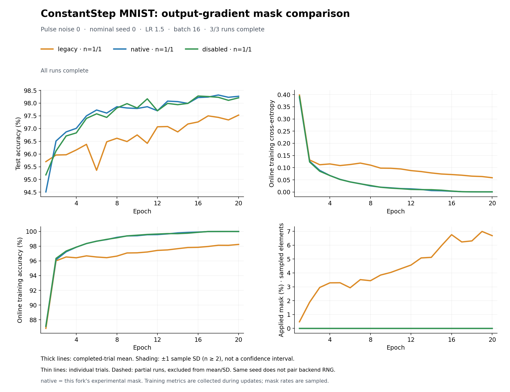

# ConstantStep MNIST: output-gradient mask comparison

Compare `legacy`, `native`, `disabled`, and `workaround`. The first three
change only the mask policy; `workaround` keeps legacy masking and disables
forward noise management and bound management. Backward settings stay fixed. Here `native` is this fork's experimental clipping-mask implementation.
The network is a dense 784–256–128–10 classifier with sigmoid hidden layers,
using standalone ConstantStepDevice, LR 1.5 and batch 16.

The default campaign runs **five separate trials per mode at nominal seed 0**:
20 runs, each with 30 epochs of full MNIST. Repetitions share initialization and
data order; they do not assume paired backend pulse randomness. The completed
[one-trial pilot](sample_results/pilot_seed0/README.md) is separate from this
campaign and is not counted toward its five trials.

## Run

Build this fork once using the [CPU/CUDA build instructions](../README.md#2-this-fork-build-once-then-compare-three-policies).
An existing matching extension can be reused. Training requires Torch,
Torchvision, NumPy and Matplotlib; plotting saved results needs only Matplotlib.

From the repository root, in the environment containing that build:

```bash
conda activate aihwkit_upstream_env
export LD_LIBRARY_PATH="$CONDA_PREFIX/lib${LD_LIBRARY_PATH:+:$LD_LIBRARY_PATH}"
export PYTHONPATH=src:.

# List the 20 runs without loading MNIST, importing Torch or using the GPU.
python issue_experiments/output_gradient_mask/mnist/run_constantstep_noise.py --dry-run

# Five trials per mode, all at the same nominal seed.
python -u issue_experiments/output_gradient_mask/mnist/run_constantstep_noise.py \
  --device cuda --seeds 0 --trials 5 --pulse-noise 0 --epochs 30
```

The dataset must already exist under `data/DATASET` (or `--data-dir`). To download
it explicitly when needed, run this once before training:

```bash
python -c 'from torchvision.datasets import MNIST; MNIST("data/DATASET", train=True, download=True); MNIST("data/DATASET", train=False, download=True)'
```

CUDA requests fail if the GPU or CUDA backend is unavailable; there is no CPU
fallback. Use `--device cpu` explicitly for a CPU campaign. To change repetitions,
use `--trials N`. Additional nominal seeds or pulse-size noises can be selected
with `--seeds 0 1` or `--pulse-noise 0 0.02 0.05`; these are not run by default.
Use a new `--output-dir` when changing settings or code.

## Results and resume

Default output: `issue_experiments/output_gradient_mask/mnist/results/constantstep_mask_comparison/`
from the repository root.

Repeat the same command to skip verified completed runs. Interrupted runs are
archived and restart at epoch 1. There is no mid-epoch or checkpoint resume.
Settings and execution-code/binding fingerprints prevent mixing different
campaigns. Each trial runs in a fresh process; trials execute sequentially,
with legacy, native, disabled, workaround in that order within each trial.

Python regenerates a six-panel PNG (two rows, three columns) after each saved
epoch; no watcher process is needed. When all runs finish, it also writes a PDF.
The left column shows full test and online training accuracy curves; the right
column shows online training loss and sampled mask rate. The narrower center
column magnifies epochs 20–30: test accuracy 97.8–98.6% above, online training
accuracy 99.75–100.02% below (with headroom above 100%). The detail panels use
the same observations and statistics as the full views; out-of-window curves
are cropped only in these panels. Before epoch 20, they show a waiting label.

**Thick lines show the mean of completed trials; shaded regions show ±1 sample
standard deviation (not a confidence interval), without band outlines.** Thin lines show individual
trials. Partial runs use dashed lines and are excluded from the mean and SD.
The legend reports completed/planned trial counts; no band is drawn for n=1.
Noise/seed combinations have separate figures and are never pooled.

`summary.csv` contains individual trial metrics. `trial_summary.csv` contains
final test-accuracy means and sample SDs across completed trials. Accuracy values
in CSV are fractions; plots show percentages. Last-five-epoch fluctuations in
`summary.csv` describe a trajectory, not between-trial variability.

## Redraw without training

This reads saved CSV/JSON only and writes PNG/PDF. It does not require Torch,
AIHWKit, model checkpoints or a GPU. Existing figure files at the destination
are replaced; measurement files are not changed.

```bash
python issue_experiments/output_gradient_mask/mnist/plot_training_comparison.py \
  --input issue_experiments/output_gradient_mask/mnist/results/constantstep_mask_comparison

# Redraw the published pilot into a separate directory.
python issue_experiments/output_gradient_mask/mnist/plot_training_comparison.py \
  --input issue_experiments/output_gradient_mask/mnist/sample_results/pilot_seed0 \
  --output-dir /tmp/constantstep_pilot_figures
```

## Workaround condition

`workaround` is a comparison-condition name, **not a new simulator mask mode**.
It sets `forward.output_gradient_mask_mode="legacy"`,
`forward.noise_management=NONE`, and `forward.bound_management=NONE`.
Backward noise management remains ABS_MAX. ADC/DAC bounds, resolution, device,
optimizer, initialization, and sample order are unchanged. The backend does not
support backward bound management; its existing configuration field is retained.

| Condition | Mask policy | Forward NM | Forward BM | Backward NM |
| --- | --- | --- | --- | --- |
| legacy | legacy | ABS_MAX | ITERATIVE | ABS_MAX |
| native | native | ABS_MAX | ITERATIVE | ABS_MAX |
| disabled | disabled | ABS_MAX | ITERATIVE | ABS_MAX |
| workaround | legacy | NONE | NONE | ABS_MAX |

Turning off forward management avoids the dynamic restoration mismatch but can
increase real ADC clipping. It does not make forward perfect or guarantee the
same learning behavior as `native`. The legacy 0.999 boundary heuristic remains.
The two management settings are available in upstream; this comparison runner
continues to require the fork build for its common diagnostics and validation.

All four conditions use the same runner, summaries and six-panel plot. To run
only the additional condition in a new campaign:

```bash
PYTHONPATH=src:. python -u \
  issue_experiments/output_gradient_mask/mnist/run_constantstep_noise.py \
  --modes workaround --device cuda --seeds 0 --trials 10 --pulse-noise 0 --epochs 30 \
  --output-dir issue_experiments/output_gradient_mask/mnist/results/workaround_trials10_epochs30
```

To retain the original three-condition selection, pass
`--modes legacy native disabled`. Existing completed three-condition results can
still be plotted, but do not reuse their output directory for a changed campaign.

## Measured pilot

The existing full-MNIST CUDA pilot has one 20-epoch trial per mode at seed 0 and
pulse-size noise 0. Final test accuracy was **97.53% legacy, 98.27% native and
98.21% disabled**. These are individual runs, not five-trial means. Runtime pulse
randomness was not paired, so repeated trials are needed to quantify the
accuracy difference and its variability.



See the [pilot report and recorded provenance](sample_results/pilot_seed0/README.md),
[full protocol](CONSTANTSTEP_NOISE.md), and [implementation/validation record](IMPLEMENTATION_LOG.md).
The published snapshot contains measurements and figures, not datasets or model
checkpoints. The issue's small numerical reproducer remains a separate experiment.
