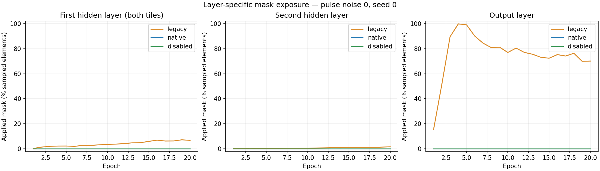

# ConstantStep MNIST: one-trial pilot

This snapshot contains three completed full-MNIST CUDA runs: one each for
`legacy`, `native` and `disabled`, at nominal seed 0 and pulse-size noise 0.
Each ran for 20 epochs. It is separate from the new default five-trial campaign.
No additional training was run when preparing this publication.

## Observed learning results

| Mode | Final test accuracy (%) | Final online training accuracy (%) | Final training cross-entropy |
| --- | ---: | ---: | ---: |
| legacy | 97.53 | 98.2350 | 0.058619 |
| native | 98.27 | 99.9983 | 0.000404 |
| disabled | 98.21 | 99.9900 | 0.000702 |

Native finished 0.74 percentage points above legacy in this comparison. Both
native and disabled reached substantially lower training loss than legacy.
These are observed individual runs, not estimates of a five-trial mean or
between-trial variability. Backend pulse randomness was not paired across modes.


Each line is one completed trial; no SD band is estimated for n=1. Training
metrics were accumulated during weight updates. Test metrics use the full
10,000-image test set after each epoch. Mask rates sample batch 1 and every
250th batch and combine elements across four physical tiles.

## Mask and weight diagnostics

At the final epoch, the sampled output-layer values were:

| Mode | Applied mask (%) | Error norm after/before | Physical weights at a bound (%) |
| --- | ---: | ---: | ---: |
| legacy | 70.117 | 0.270196 | 4.531 |
| native | 0.000 | 1.000000 | 4.609 |
| disabled | 0.000 | 1.000000 | 3.516 |

On the native run's same sampled output-layer forward calls, actual ADC clipping
was 0%, while the legacy threshold would have flagged 56.211% of outputs. This
comparison uses the same forward tensors. Comparisons between full training
runs use different trajectories.



The error-norm ratio is the sum of post-mask L2 norms divided by the sum of
pre-mask L2 norms over sampled batches. Weight-bound occupancy is measured on
physical weights. The underlying observations are in each run's `diagnostics.csv`
and `weights.csv`; final-layer summaries are in `diagnostic_summary.csv`.

## Conditions and provenance

The [protocol](../../CONSTANTSTEP_NOISE.md) specifies the full experiment:
784–256–128–10 sigmoid network, digital bias, LR 1.5, batch 16, standalone
ConstantStepDevice with dw_min=0.002 and bounds ±2, non-perfect ONE_PASS I/O,
output bound 12, and resolution 1/4094. There was no DCSR or refresh.

The original `campaign.json` records source commit
`f63f47554c48ed2e0bccf7213ee176eaffd79889`, the uncommitted runner state,
Torch 2.9.1+cu126, Python 3.12.12, RTX 4080 SUPER, package/binding paths and hashes.
These measurements used this fork's experimental compiled extension, retaining
original behavior in legacy mode. They were not run with a pristine upstream
binary. The archived `executed_runner.py` matches its recorded SHA-256.
It is historical source evidence, not the current training entrypoint.

Programmed initial weight/bias hashes match across all three runs, as do every
epoch's permutation hashes. There are four physical tiles, with the first layer
split across two tiles. Noise 0 refers to pulse-size noise; update pulse
creation is still stochastic.

All copied JSON and the executed runner are unchanged. CSV line endings were
normalized from CRLF to LF, with no field changes. `publication.json` records
both original and published hashes and the plotter hash used for the new
comparison image. Dataset files, models and build artifacts are omitted.
Original per-run records remain under `noise_0/seed_0/<mode>/`; the plot reader
interprets the older schema without a trial ID as trial 1.

An earlier attempt was stopped after five legacy epochs to correct a plotting
visibility issue. Its records remain in the local archive. The seed and learning
conditions were unchanged; this snapshot contains only the subsequent completed
campaign, rather than selecting epochs from the interrupted attempt.

## Redraw and repeat

From the repository root, using Python with Matplotlib:

```bash
python issue_experiments/output_gradient_mask/mnist/plot_training_comparison.py \
  --input issue_experiments/output_gradient_mask/mnist/sample_results/pilot_seed0 \
  --output-dir /tmp/constantstep_pilot_figures
```

Use the [current runner](../../README.md) for a new five-trial campaign. This
published directory is a measurement archive and contains no resume checkpoints.
A single trial per mode cannot establish that the mask explains earlier
trial-to-trial instability, or that a particular accuracy improvement generalizes.
The disabled mode is a diagnostic control, since it also ignores true clipping.
