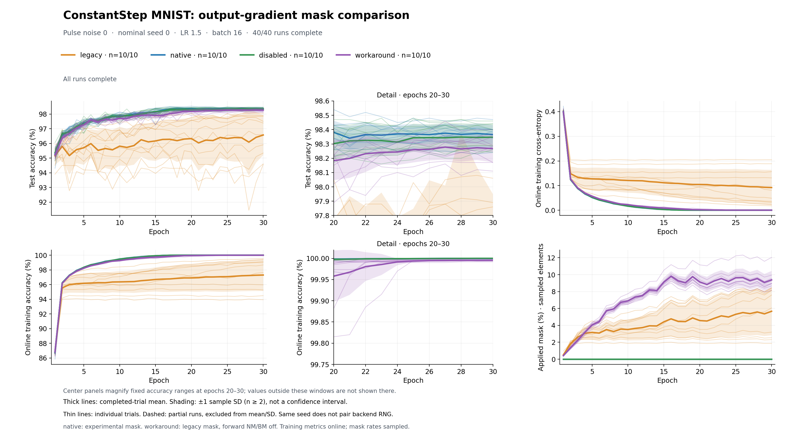

# ConstantStep MNIST: four conditions, ten trials each

These are 40 completed CUDA runs on full MNIST, each lasting 30 epochs.
The three managed conditions were run first (30 runs); `workaround` was run
later in a separate ten-run campaign. This archive combines their recorded
observations for comparison. No training was repeated to prepare it.

## Final test accuracy

| Condition | Trials | Mean (%) | Sample SD (percentage points) |
| --- | ---: | ---: | ---: |
| legacy | 10 | 96.577 | 1.3724 |
| native | 10 | 98.366 | 0.0659 |
| disabled | 10 | 98.347 | 0.0886 |
| workaround | 10 | 98.267 | 0.0942 |

These are epoch-30 values across all ten trials, not best-epoch selections.
Native's mean is 1.789 percentage points above legacy's in this setting.
Individual final values are in [summary.csv](summary.csv); group statistics
are in [trial_summary.csv](trial_summary.csv). The last-five-epoch variability
columns describe variation within a run and are not the SD in this table.



Thick lines show completed-trial means; shading shows ±1 sample SD across
trials, not confidence intervals. Thin lines are individual trials. Center
panels magnify epochs 20–30 at fixed accuracy limits; the full views retain
curves outside those windows. Training metrics are accumulated during updates;
test accuracy uses the full 10,000-image test set after each epoch. Mask rates
are sampled from existing calls, not measured with additional forward passes.

## What differs between conditions

| Condition | Output-gradient mask | Forward noise management | Forward bound management |
| --- | --- | --- | --- |
| legacy | Original threshold | ABS_MAX | ITERATIVE |
| native | Fork's final ADC clipping mask | ABS_MAX | ITERATIVE |
| disabled | No output-gradient mask | ABS_MAX | ITERATIVE |
| workaround | Original threshold | NONE | NONE |

Backward noise management stays ABS_MAX in every condition. `workaround` is
a comparison label, not a fourth backend mask policy. It uses existing upstream
management settings, but also changes forward computation and can increase real
clipping. Its accuracy is therefore not an isolated measurement of a mask-only
change. The legacy 0.999 threshold remains. Disabled is a diagnostic control
that also passes gradients through real clipping.

The [protocol](../../CONSTANTSTEP_NOISE.md) specifies the shared settings:
784–256–128–10 sigmoid network, digital bias, full MNIST with no augmentation,
AnalogSGD, constant LR 1.5, batch 16, standalone ConstantStepDevice,
dw_min=0.002, weight bounds ±2, output bound 12, non-perfect ONE_PASS,
resolution 1/4094, pulse-size noise 0, and enabled update/bit-length management.
The first layer is split across two tiles; there are four physical tiles.

All runs use nominal seed 0, with identical programmed initial weight/bias
hashes and all 30 epoch-permutation hashes. Trial IDs do not change the seed.
Stochastic pulse generation remains enabled at pulse-size noise 0; backend
pulse randomness is not paired across runs. These ten repetitions measure
variation at one initialization and data order, not variation across seeds.
The observed effect concerns this training setup and does not quantify the
impact on other architectures, settings or hardware-aware training workflows.

## Evidence and provenance

- `runs/trial_XX/condition/`: original learning/diagnostic/weight CSVs, device
  configuration, run specification, completion status, summary and data hashes.
- `provenance/baseline_snapshot/` and `provenance/workaround/`: each original
  campaign manifest and archived runner/plotter source.
- [publication.json](publication.json): original and published SHA-256 hashes
  for all 326 copied artifacts, matching initialization/data-order evidence,
  and the plotter hash used for this figure.
- [campaign.json](campaign.json): a plotting-only manifest with portable
  relative paths and unchanged original run specifications.

Every copied artifact is byte-identical to its local source. The original
specifications keep their machine paths and execution identities. The two
campaigns used the same simulator source hash and compiled binding hash,
Python 3.12.12, Torch 2.9.1+cu126 and RTX 4080 SUPER. They used this fork's
experimental build, with legacy behavior retained, not a pristine upstream
binary. The archived runner hashes match their campaign records; their model,
data-order helpers and training loop also match structurally.

The later campaign used a private one-off adapter to check compatibility with
the original runs, validate initial weights/data order, and update the combined
view. Its hash and purpose are recorded, but the adapter is not distributed.
The public runner now supports all four conditions directly. Archived Python
files are historical evidence, not the current entrypoints. Datasets, model
checkpoints, build outputs and the private temporary workspace are excluded.

## Redraw or run a new comparison

From the repository root, redraw these saved observations with Matplotlib only:

```bash
python issue_experiments/output_gradient_mask/mnist/plot_training_comparison.py \
  --input issue_experiments/output_gradient_mask/mnist/sample_results/seed0_trials10_epochs30 \
  --output-dir /tmp/constantstep_four_condition_figures
```

After building this fork as described in the [training instructions](../../README.md),
run all four conditions in a new output directory:

```bash
PYTHONPATH=src:. python -u \
  issue_experiments/output_gradient_mask/mnist/run_constantstep_noise.py \
  --device cuda --seeds 0 --trials 10 --pulse-noise 0 --epochs 30 \
  --output-dir issue_experiments/output_gradient_mask/mnist/results/four_conditions_seed0_trials10_epochs30
```

This schedules 40 new runs. The default without `--trials 10` is five trials
per condition. Figures update after every epoch. Repeating the same command
resumes at the condition level; changing code/settings requires a new output
directory. This published archive has no checkpoints and cannot resume training.
